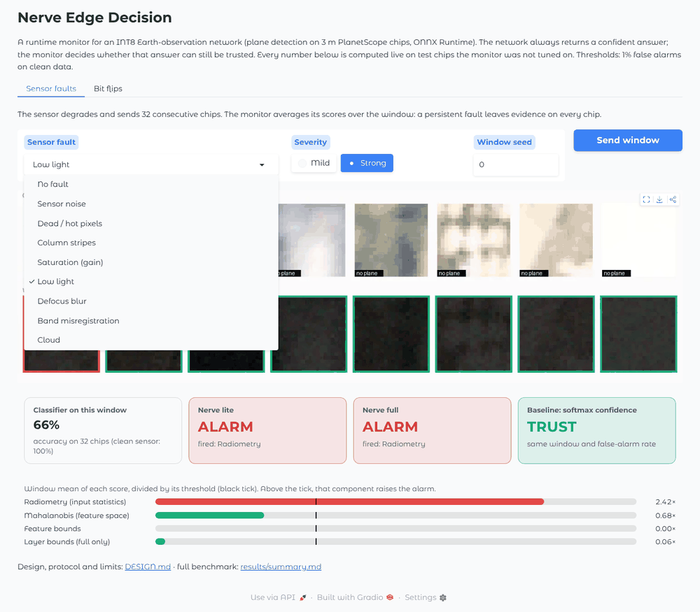
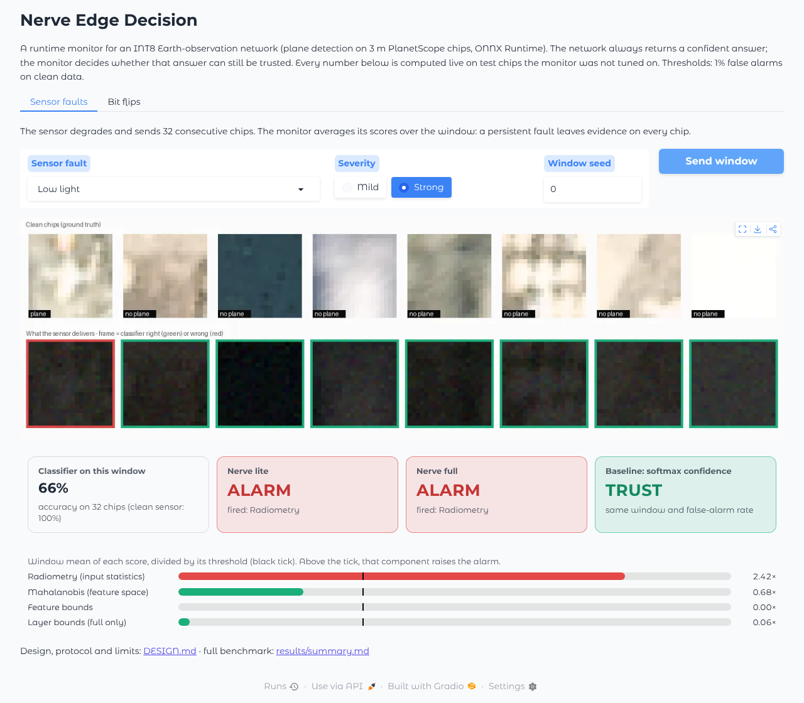
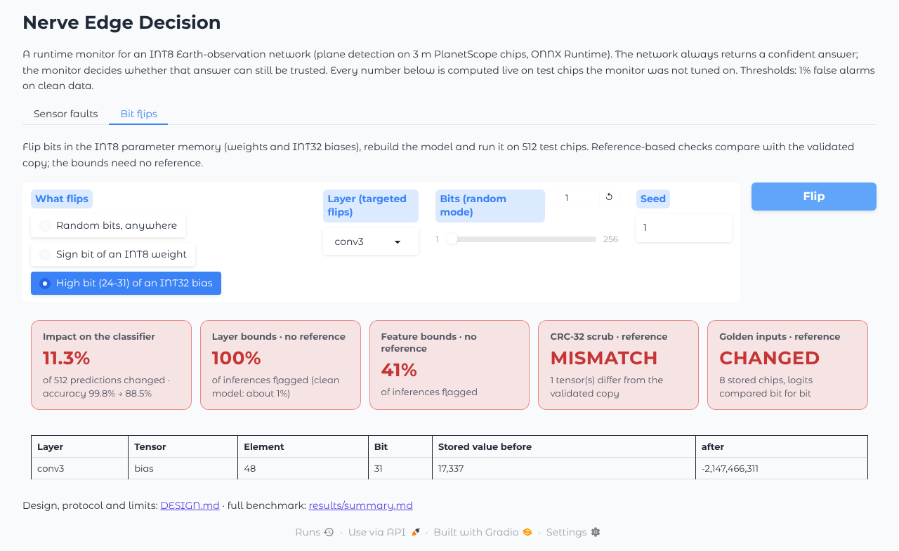
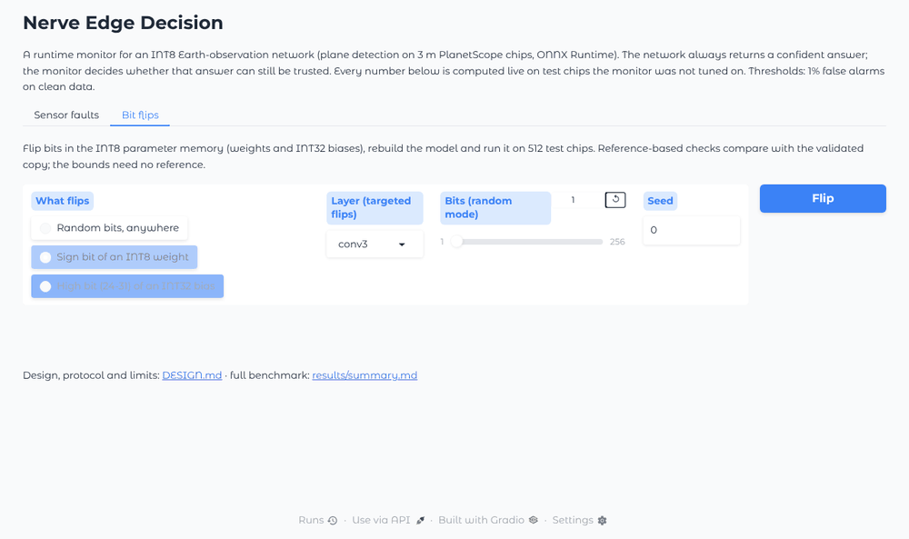
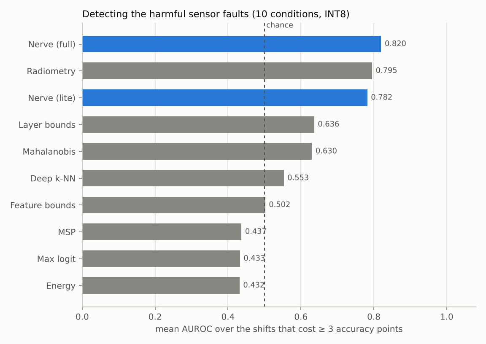
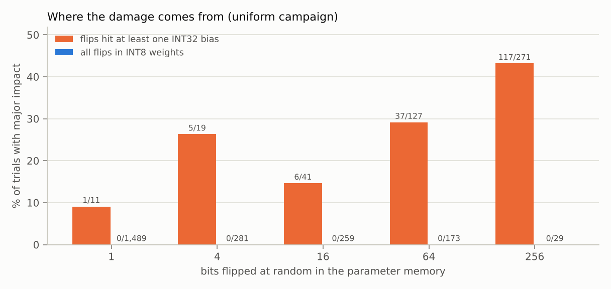

# Nerve Edge Decision

[](https://github.com/JolanMc/nerve-edge-decision/actions/workflows/ci.yml)


**Should the edge trust its own network's decision right now?** Nerve Edge
Decision is a runtime monitor for INT8 neural networks. It watches a small
convolutional network quantised with ONNX Runtime and asks, at every
inference: *is this still the validated network, running on the kind of input
it was validated on?* It flags inputs outside the validated domain (sensor
faults, foreign scenes) and bit flips in the quantised parameters, and it
measures what each check costs in accuracy, latency and memory.

<p align="center">
  
</p>

The network never says when it is wrong: under low light it still answers with
high confidence, and a softmax-based check trusts it. The monitor reads the raw
chip and the network's own activations, and raises the alarm.

The test case is Earth observation: plane detection on 20 × 20 PlanetScope
chips (PlanesNet, 3 m per pixel). One command trains the network, quantises it,
fits the monitor, runs 17 input conditions and 3,400 bit-flip trials, and
writes every number in [`results/summary.md`](results/summary.md). The design,
the protocol and the limitations are in [`DESIGN.md`](DESIGN.md).

## Try it

```bash
git clone https://github.com/JolanMc/nerve-edge-decision.git && cd nerve-edge-decision
python -m pip install -e ".[demo]"
make demo          # then open http://127.0.0.1:7860
```

The INT8 model ships in `models/`; PlanesNet (about 26 MB) is downloaded and
checked on first start, and the monitors are fitted in a few seconds on a CPU.
No GPU, no PyTorch needed for the demo.

| Sensor faults | Bit flips |
|---|---|
|  |  |
| Pick a fault and a severity; the sensor sends 32 chips. Green or red frames show whether the classifier is right; the cards show what the monitor and a softmax baseline decide, and which signal fired. | Flip the sign bit of a weight, a high bit of a bias, or up to 256 random bits; the model is rebuilt and run on 512 chips. Compare the impact with what each check sees, with and without a reference copy. |

<p align="center">
  
</p>

The demo sets its thresholds for 1 % false alarms on half of the clean test
chips and shows the other half. In stream mode it averages each score over
the window, since a degraded sensor degrades every chip that follows; the
benchmark below scores single chips.

## Results (v0.1, one seed)

* **Quantisation.** INT8 accuracy 98.81 % on 6,411 chips from scenes never seen
  in training, against 98.86 % in FP32; 144,874 bytes of parameters instead of
  558,728.
* **Unusual inputs.** On the 10 simulated sensor faults that cost the
  classifier at least 3 accuracy points, scores built on the softmax output do
  worse than chance (mean AUROC 0.43 to 0.44): a corrupted chip gets a *more*
  confident output. The Nerve Edge Decision score reaches 0.78 (lite) and 0.82 (full).
  Strong blur and a strong cloud are barely detected by any signal tested (best
  AUROC 0.55 and 0.64).
* **Bit flips.** 98.7 % of single random flips change no prediction. In the
  uniform campaign, none of the 2,231 trials whose flips all fell in the INT8
  weights changed more than 1 % of the predictions, even with 256 flipped bits;
  all 166 trials that did had flipped a bit of an INT32 bias. The biases are
  1,288 bytes, 0.9 % of the parameter memory. In the trials where a flip in the
  high bits of a bias mattered, the per-layer activation bounds flag 98.8 % of
  inferences, with no reference copy of the weights.
* **Cost.** The lite monitor reads only the input chip and the pooled features
  the network computes anyway: no measurable latency overhead, a decision step
  of about 0.3 % of the network's multiply-accumulates, and 67.7 kB of state
  (33.6 kB with float16).

<p align="center">
  
  
</p>

## How it works

```
PlanesNet chip ──► EdgeNet INT8 (ONNX Runtime) ──► logits
     │                      │
     │                      ├─ pooled features ──► Mahalanobis, feature bounds ─┐
     │                      └─ per-layer maxima ──► layer bounds (full only) ───┤
     └─ band statistics ──────────────────────────► radiometry ─────────────────┤
                                                                                ▼
                                         conformal p-values ──► min p ──► alarm
```

| Signal | Catches | Needs a reference copy of the weights |
|---|---|---|
| Radiometry: 12 statistics of the raw chip | exposure, saturation, dead pixels | no |
| Mahalanobis on the 128 pooled features | inputs that look new to the network | no |
| Feature bounds, layer bounds | saturated or dead channels after a fault | no |
| CRC-32 scrub, golden inputs (for comparison) | any change of the memory or of the computation | yes |

Each signal is turned into a conformal p-value against clean validation data;
the alarm fires when one of them is too small. The **lite** monitor (radiometry,
Mahalanobis, feature bounds) leaves the network's latency unchanged; the
**full** monitor adds per-layer bounds, which ONNX Runtime computes with five
extra ReduceMax operators (+43 % latency at batch 1 on the host CPU).

Baselines: maximum softmax probability, max logit, energy, Mahalanobis and deep
k-nearest neighbours, five of the methods implemented in DEEL's
[oodeel](https://github.com/deel-ai/oodeel) library, re-implemented here in
NumPy so that they run on the outputs of the INT8 graph.

## Reproduce the benchmark

```bash
python -m pip install -e ".[train,dev]"
make all     # download, train, quantise, benchmark, report: about 20 min on 2 CPU cores
make test    # unit tests on a tiny ONNX network, no PyTorch or download needed
make quick   # smoke test of the whole pipeline in about 2 min (meaningless numbers)
```

The datasets are downloaded at pinned commits and checked (PlanesNet against a
SHA-256 digest). On a given machine and set of package versions, every stage is
deterministic except timings; another CPU or library version can shift the
trained weights, and therefore the numbers, slightly. The versions of the
reported run are in [`requirements-lock.txt`](requirements-lock.txt).

## Repository

| Path | Content |
|---|---|
| `nerve_edge/data.py` | PlanesNet and CIFAR-10 loaders, scene-level split, the 8 sensor faults |
| `nerve_edge/model.py`, `train.py` | EdgeNet and its training |
| `nerve_edge/export.py` | ONNX export, INT8 quantisation, monitor taps added by graph surgery |
| `nerve_edge/monitor.py` | every score, the conformal fusion, the window thresholds |
| `nerve_edge/faults.py`, `integrity.py` | bit-flip injection in the INT8 parameter memory, CRC-32, golden inputs |
| `nerve_edge/pipeline.py`, `report.py` | the experiment and its report |
| `nerve_edge/live.py`, `demo.py` | the live monitor and the interactive demo (Gradio) |
| `models/` | the INT8 model of the reported run, with its monitor outputs |
| `docs/img/` | demo screenshots and recordings |
| `results/` | `summary.md`, `metrics.json`, every fault trial (`fault_trials.jsonl.gz`), figures |
| `tests/` | unit tests, run by CI on Python 3.10 to 3.13 |

## Limitations

One dataset, one small network, one seed; simulated sensor faults; bit flips in
the parameter memory only; timings from a cloud CPU, not an embedded target.
The radiometry signal and the fusion were added after a preliminary run on the
same corruption set. Details in [`DESIGN.md`](DESIGN.md#8-limitations).

## Data and licences

* PlanesNet, by R. Hammell, from Planet's Open California imagery, CC BY-SA 4.0
  ([github.com/rhammell/planesnet](https://github.com/rhammell/planesnet)).
* CIFAR-10 (Krizhevsky, 2009), test images only, used as far out-of-distribution
  inputs.
* Neither dataset is redistributed here. The code is under the Apache License
  2.0.

## Related work by the author

[Jorak](https://github.com/JolanMc/Jorak) asks the same question of open-weight
language models: it tells whether a model's refusal behaviour was removed by
weight editing, without the original model.

If you use Nerve Edge Decision, see [`CITATION.cff`](CITATION.cff).
